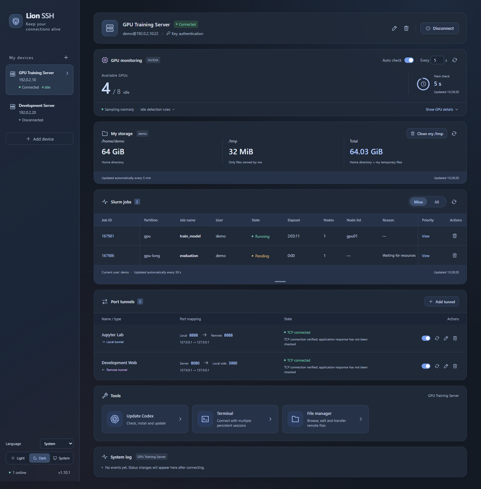

<p align="center"><strong>English</strong> · <a href="README.zh-CN.md">简体中文</a></p>

<h1 align="center">Lion SSH | </h1>

<p align="center">SSH connections, server monitoring, and everyday tasks in one simple desktop workspace.</p>



<p align="center">Workspace preview · demo data</p>

## Features

| Feature | What it does |
| --- | --- |
| Multiple SSH connections | Connect to servers independently using passwords, keyboard-interactive authentication, or private keys with optional passphrases. Confirm host fingerprints on first connection. |
| Multi-hop SSH | Add and reorder jump hosts, configure credentials for each hop, and test each hop or the target before saving. |
| Port tunnels | Manage forward and reverse tunnels with multiple rules, failure detection, and automatic recovery. |
| NVIDIA GPU monitoring | See GPU usage, idle counts, process owners and per-GPU process details; confirm before ending your own processes. Supports scheduled checks, pause, and manual refresh. |
| Slurm job management | View your jobs or all jobs, inspect status and queue reasons, query Priority, and cancel your own jobs after confirmation. |
| SFTP file manager | Browse remote directories, edit text, preview images, transfer files and folders, and copy between servers. |
| Personal storage | Count your files in accessible directories, skipping permission-denied paths; preview and confirm cleanup of your own temporary files. |
| Chinese and English | Chinese system locales default to Chinese; all other locales default to English. Manually choose 中文, English, or System, with your preference saved. |
| Themes and system tray | Choose light, dark, or system appearance. Closing the window keeps connections and monitoring running in the tray. |
| Logs and credentials | Review connection and tunnel logs. Remembered passwords and key passphrases are protected by system secure storage. |

## Language

The default is **System**: Chinese system locales use Simplified Chinese, and all other system locales use English. In the bottom-left sidebar, use **Language** to choose **中文**, **English**, or **System** at any time. Changes apply immediately, and your choice is saved for the next launch.

Interface labels, dialogs, notifications, and tray menus follow this preference. Server names, custom terminal names, and remote terminal output keep their original content.

## Jump hosts and connection tests

When adding or editing a device, use **Add jump host** above the target's connection settings. Hosts connect from top to bottom, followed by the target server. Each hop supports a password or a local private key with an optional passphrase. Use the up/down buttons to change the order, or remove all jump hosts to connect directly.

Each jump host and the target have a **Test connection** button. Testing a hop connects through the preceding hops; testing the target checks the full chain. Tests work before saving, support cancellation, and ask you to confirm unfamiliar host fingerprints. They do not replace an existing device connection. Jump hosts must allow SSH TCP forwarding to the next host.

Terminals, SFTP, monitoring and port tunnels use the target connection through the configured chain. Remember credentials separately for each hop and the target when needed for automatic reconnection.

## GPU processes

On Linux NVIDIA servers, GPU cards show unique process owners, excluding Xorg. The user with the highest PID appears first; a `+N` badge indicates additional users. Hover over the badge to see only those other users in a custom list. A single-user badge has no popup.

Click a GPU card to open its process table, showing PID, process name, user, elapsed time, GPU memory and process type. It follows the GPU monitoring interval and also supports manual refresh. Only your own processes have a stop action: choose **Cancel**, **Terminate** or **Force stop** in the confirmation dialog. The backend rechecks ownership and process identity before signaling that PID. Ending a process does not actively cancel a Slurm job that launched it.

The panel opens and closes with a Gaussian blur transition. Clicking outside, clicking `×` and pressing Escape all return the panel to its GPU card. The card and table crossfade at the same intermediate size in both directions, so the table appears while the panel is still expanding. Text follows the app theme, the page keeps its scrollbar space, and reduced-motion preferences are respected.

## Tools

### Codex update

Install or update Codex CLI on the selected server with one click. See the installed and latest stable versions; the tool detects the official installer or npm and preserves the installation method.

Native packages are downloaded from official sources and verified on your computer, then transferred over SSH to work around restricted server downloads.

It updates running official managed daemons or restarts verified native systemd user services, then reports version verification and restart results. Reopen ordinary interactive Codex sessions to use the new version. Operations preserve the current SSH user and original installation directories, without `sudo`.

### Command line (Terminal)

Open remote terminals inside the app for everyday commands, with colored output, a visible cursor, and interactive programs.

- Your first visit opens one terminal. Use `+` to add a tab and `×` to close it.
- Double-click a tab to edit its note. Each server keeps its own tabs.
- Sessions stay open when you switch pages or servers or hide the app to the tray, and close when you quit. After an SSH disconnect, reconnect and open a new terminal.
- Right-click selected text to copy; right-click without a selection to paste. `Ctrl+Shift+C` / `Ctrl+Shift+V` also work.
- Click recognized HTTP/HTTPS links to open them in your system's default browser.

### File manager

Open **Tools → File manager** on a device to browse over SFTP using its existing SSH connection.

- The remote path field offers directory suggestions, Enter to navigate and Tab to complete. Click a folder to expand/collapse it; use the right-arrow button on its selected row to enter it. Double-clicking does not change the current directory. The tree supports multiple selection, inline creation/renaming, icon tooltips and context menus.
- Material Icon Theme icons distinguish common file types in the tree and open tabs. Folder icons reflect expanded/collapsed states, and icons update as you create or rename files. Only the required SVGs are bundled for offline use.
- Open multiple text/image tabs. Text editing includes syntax highlighting, undo/redo, cut/copy/paste, Ctrl/Cmd+S, and search/replace with localized labels and light/dark themes. LF, CRLF and CR line endings, including mixed training logs, display correctly and retain their original separators when editing or undoing. Closing dirty tabs prompts to save; externally changed remote files cannot be silently overwritten.
- Preview PNG, JPEG, GIF, WebP, BMP, ICO and SVG. Use Ctrl + mouse wheel to zoom, or the zoom buttons to adjust/reset the image size.
- The upload icon offers files or folders; the download button selects a local directory. Only the file tree accepts external drops, highlighting the destination folder. Drag out to download. Copy/paste works within and between servers.
- Drag within the tree to move after confirming source and destination paths. Delete via the toolbar, context menu or Delete key after confirmation. Clicking tree whitespace clears selection and commits an inline name; an empty name cancels creation.
- The transfer panel shows bytes, progress, speed, elapsed time and ETA; speed and ETA refresh once per second. Right-click to pause, resume, cancel, retry or resolve name conflicts. Interrupted transfers resume after reconnecting within the current app session; the panel hides when all transfers finish.

Text editing supports UTF-8 and BOM-marked UTF-16 up to 5 MiB; image previews support up to 20 MiB. Larger files can still be transferred. Native drag-out uses Windows virtual files, macOS file promises and Linux URI drops. Windows/Linux drag-out requires local temporary space and shows “Drop destination folder” in the queue. Use the download button for symbolic links or paths exceeding Windows virtual-file descriptor limits.

Tool panels use the available window width with fixed side margins. Personal storage skips directories you cannot read, including inaccessible FUSE mounts. If `/tmp` is missing or inaccessible, its value is shown as `—`, it contributes zero to the total, and cleanup is disabled; other scan errors still report a warning.

## Download

**[Download the latest release](https://github.com/ZjDing42/LionSSH/releases/latest)** · [v1.12.0 release notes](.github/release-notes/v1.12.0.md)

| Platform | Package |
| --- | --- |
| Windows x64 | Multi-file portable ZIP / EXE installer |
| macOS Apple Silicon | DMG |
| Linux x86_64 | AppImage |

Starting with releases after v1.12.0, macOS packages are available only for Apple Silicon (M-series) Macs. [v1.12.0](https://github.com/ZjDing42/LionSSH/releases/tag/v1.12.0) is the final supported release for Intel (x86_64) Macs.

Windows requires [WebView2 Runtime](https://developer.microsoft.com/microsoft-edge/webview2/); the installer downloads it if missing. The default installation directory is `%LOCALAPPDATA%\Programs\Lion SSH`, and you can choose another location.

macOS packages use a full ad-hoc application signature. CI verifies the built app, the DMG and the updater archive, then checks packaged-app startup on an Apple Silicon runner. Failed checks prevent publication as Latest. Packages are not Developer ID signed or notarized by Apple. After copying the app to Applications, you may need to allow it in **System Settings → Privacy & Security → Open Anyway** if you trust the download. See [Apple's instructions](https://support.apple.com/en-us/102445).

## Data

Both Windows editions use `data/` beside the executable and retain the existing JSON formats. macOS and Linux use system user data directories; `LION_DATA_DIR` can override the location. Saved credentials are bound to the current system account and secure store.

## Development and building

Built with **Tauri 2 + Rust + Vue 3 + TypeScript**. Release packages do not need Node.js. Development requires Node.js **22.12+**, Rust **1.90+**, and the [Tauri prerequisites](https://v2.tauri.app/start/prerequisites/).

```sh
npm ci
npm start
npm run dist:win
```

Windows build artifacts are written to `release/` and include a portable ZIP and an EXE installer. Release builds require [Tauri update signing](https://v2.tauri.app/plugin/updater/).

## License

[Apache License 2.0](LICENSE). Third-party dependencies retain their respective licenses and copyright notices.
