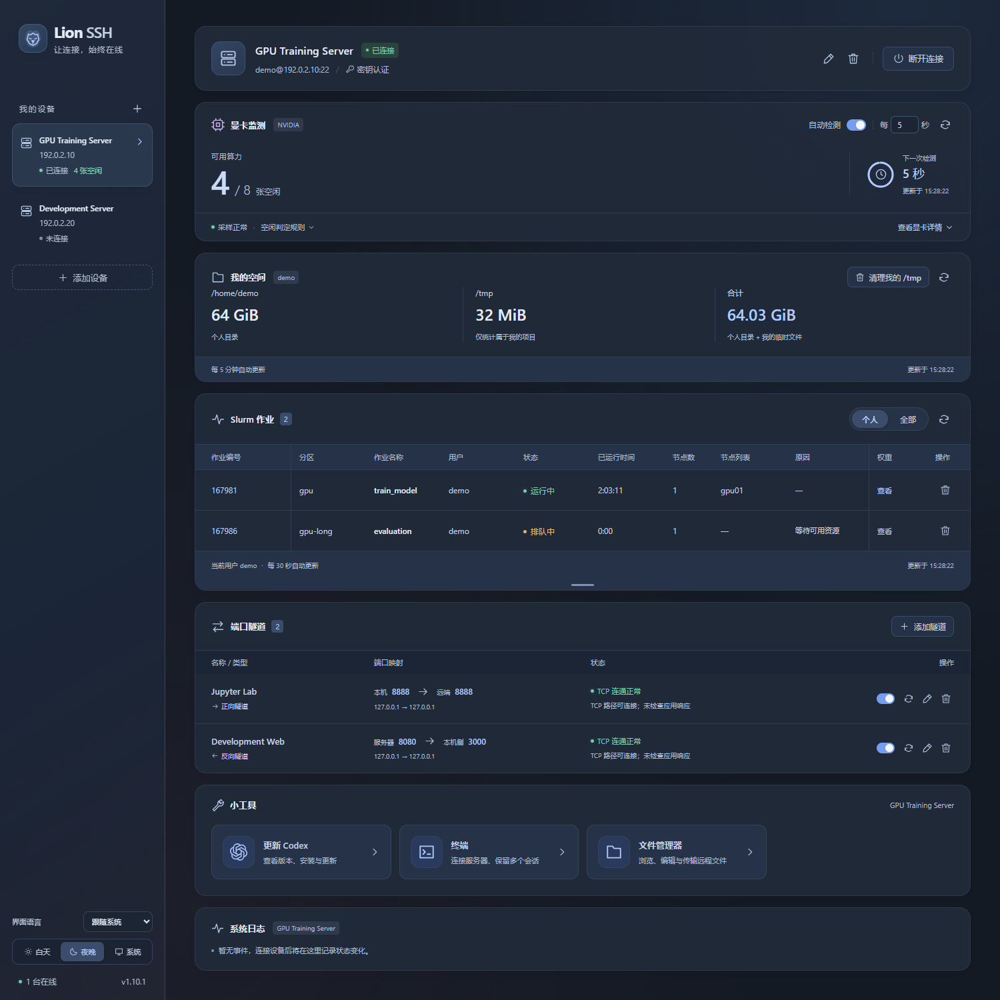

<p align="center"><a href="README.md">English</a> · <strong>简体中文</strong></p>

<h1 align="center">Lion SSH | </h1>

<p align="center">把 SSH 连接、服务器监测和日常操作，放在一个简洁的桌面工作台里。</p>



<p align="center">工作台预览 · 演示数据</p>

## 功能

| 功能 | 说明 |
| --- | --- |
| 多设备 SSH | 独立连接多台服务器，支持密码、交互式密码、私钥及私钥口令，首次连接确认主机指纹。 |
| 多级跳板机 | 添加并调整跳板机顺序，分别配置各级凭据，保存前可测试每级跳板机或目标服务器。 |
| 端口隧道 | 正向 / 反向转发，多条规则独立管理，异常检测与自动恢复。 |
| NVIDIA 显卡监测 | 查看显卡使用情况、空闲数量、使用者及各卡进程详情，确认后结束自己的进程；支持定时检测、暂停和手动刷新。 |
| Slurm 作业管理 | 查看个人 / 全部作业、作业状态与排队原因，查询 Priority，确认后取消自己的作业。 |
| SFTP 文件管理器 | 浏览远程目录、编辑文本、预览图片、传输文件及文件夹，并在不同服务器之间复制。 |
| 个人空间 | 只统计可访问目录中的本人文件，跳过权限不足的目录；预览并确认后清理自己的临时文件。 |
| 中英文界面 | 中文系统默认中文，其他语言系统默认英文；可手动选择中文、English 或跟随系统，并保存偏好。 |
| 外观与托盘 | 白天、夜晚、跟随系统三种主题；关闭窗口后常驻托盘，保留连接和监测。 |
| 日志与凭据 | 查看连接及隧道日志，通过系统安全存储保护记住的密码和私钥口令。 |

## 界面语言

默认选择**跟随系统**：中文系统显示简体中文，其他语言系统显示英文。可以随时在左下角侧栏的**界面语言**中切换为**中文**、**English** 或**跟随系统**，立即生效，并在下次启动时继续保留。

界面文字、对话框、通知和托盘菜单均遵循语言偏好。服务器名称、自定义终端备注以及远程终端输出保留原始内容。

## 跳板机与连接测试

添加或编辑设备时，可在目标机连接信息上方点击**添加跳板机**。程序按从上到下的顺序逐级连接，最后到达目标服务器。每级可独立使用密码或本地私钥及可选的私钥口令；通过上移、下移按钮调整顺序，删除全部跳板机后恢复直连。

每级跳板机和目标机均有**测试连接**按钮。测试某级跳板机时，先经过它前面的跳板机；测试目标机时，检查完整链路。无需先保存即可测试，支持取消，遇到未确认的主机指纹时会提示确认，已有设备连接不受测试影响。各跳板机需允许通过 SSH TCP 转发访问下一台主机。

终端、SFTP、监测和端口隧道通过配置的链路使用目标机连接。需要自动重连时，可按需分别记住每级跳板机及目标机的凭据。

## GPU 进程

在 Linux NVIDIA 服务器上，GPU 卡片展示去重后的进程用户名，过滤 Xorg；PID 最大的用户排在最前，`+N` 表示还有其他用户。悬停用户名时，下方自定义列表只显示其他用户；只有一个用户时不弹出列表。

点击 GPU 卡片打开进程表，查看 PID、进程名、用户、运行时长、显存占用和进程类型。列表跟随现有 GPU 检测间隔刷新，也可手动刷新。仅自己的进程提供结束按钮，确认框中可选择**取消**、**正常结束**或**强制结束**；后台会重新核对归属与进程身份，仅向该行 PID 发送信号。如果当前作业由 Slurm 提交，结束进程不会主动取消该作业。

进程表使用高斯模糊展开和收回。点击表格外空白处、点击 `×` 或按 Escape 均收回到对应 GPU 卡片。展开与收回在相同的中间尺寸交叉渐变切换卡片和表格，表格在面板继续展开时即可出现。文字沿用软件主题色，保留页面滚动条占位，并遵循系统减少动态效果的偏好。

## 小工具

### Codex 更新

在当前服务器上一键安装或更新 Codex CLI，查看已安装版本和最新稳定版；自动识别官方脚本 / npm 安装，沿用原安装方式更新。

原生安装包由本机从官方源下载并校验，再通过 SSH 传到服务器，减少服务器下载受限的影响。

更新后会更新运行中的官方托管 daemon，或重启已确认的原生 systemd 用户服务，并显示版本校验和重启结果。普通终端中的 Codex 交互会话需重新打开。操作沿用当前 SSH 用户及原安装目录，不使用 `sudo`。

### 命令行（终端）

在软件内打开远程终端，完成日常命令行操作，支持彩色输出、可见光标和交互程序。

- 首次进入默认打开一个终端，点击 `+` 新建，点击 `×` 关闭。
- 双击标签修改备注；不同服务器分别保留自己的标签。
- 切换页面、设备或隐藏到托盘后，会话继续保留，退出软件时关闭；SSH 断线后可重连并新开终端。
- 选中文字后右键复制，没有选区时右键粘贴；也支持 `Ctrl+Shift+C` / `Ctrl+Shift+V`。
- 点击识别出的 HTTP/HTTPS 链接，使用系统默认浏览器打开。

### 文件管理器

在当前设备的“小工具”中打开文件管理器，复用已有 SSH 连接进行 SFTP 操作。

- 左侧路径框支持目录提示、Enter 跳转和 Tab 补全。单击文件夹展开或折叠，选中后点击该行右侧箭头进入目录，双击不再跳转。文件树支持多选、内联新建和重命名；工具栏悬停显示名称，右键菜单提供相同操作。
- 文件树和文件标签页使用 Material Icon Theme 图标区分常见文件类型；文件夹图标区分展开和折叠状态，新建或重命名时自动更新图标。仅内置需要的 SVG，离线即可显示。
- 右侧支持多个文件标签、语法高亮、撤销/重做、剪切/复制/粘贴及 Ctrl/Cmd+S 保存；查找替换面板适配当前语言和明暗主题。正确识别 LF、CRLF、CR 及训练日志中的混合换行，编辑和撤销时保留原始换行符。未保存的标签关闭前会提示；远程文件被他人修改时拒绝直接覆盖。
- 支持 PNG、JPEG、GIF、WebP、BMP、ICO、SVG 图片预览；按 Ctrl + 鼠标滚轮缩放，也可使用缩放按钮调整或恢复图片大小。
- 点击上传图标选择上传文件或文件夹，下载按钮选择本地目录。只有左侧文件树接收外部拖放，悬停的目标文件夹会高亮；拖出到系统文件管理器下载。复制/粘贴适用于同一服务器及不同服务器之间。
- 文件树内部拖动为移动，确认源路径与目标目录后执行；工具栏、右键菜单和 Delete 键提供删除，确认后删除所选项目及文件夹内容。点击树中空白处清除选择，并提交新建名称；空名称取消创建。
- 传输面板显示字节数、进度、速度、耗时和预计剩余时间，速度与预计剩余时间每秒刷新一次；右键提供暂停、继续、取消、失败重试及同名处理。当前应用会话内断线重连后可续传，全部完成后面板自动收起。

文本编辑上限为 5 MiB（UTF-8 或带 BOM 的 UTF-16），图片预览上限为 20 MiB；较大的文件仍可传输。Windows 拖出使用虚拟文件，macOS 使用文件承诺，Linux 使用原生 URI 拖放；Windows/Linux 拖出需要本地临时空间，传输表中显示“拖放目标文件夹”。Windows 虚拟拖出不支持符号链接和超过系统描述符长度的相对路径，此时使用下载按钮。

工具操作面板随窗口宽度扩展，左右边距固定。“我的空间”跳过无权限读取的目录，包括无法访问的 FUSE 挂载点；`/tmp` 不存在或无法访问时显示 `—`，按零计入合计并禁用清理按钮，其他真实统计错误仍会显示提示。

## 下载

**[下载最新版本](https://github.com/ZjDing42/LionSSH/releases/latest)** · [v1.12.0 更新日志](.github/release-notes/v1.12.0.md)

| 平台 | 发行格式 |
| --- | --- |
| Windows x64 | 多文件便携 ZIP / 安装包 EXE |
| macOS Apple Silicon | DMG |
| Linux x86_64 | AppImage |

从 v1.12.0 之后的版本开始，macOS 仅提供 Apple Silicon（M 系列）发行包。Intel（x86_64）Mac 的最后支持版本为 [v1.12.0](https://github.com/ZjDing42/LionSSH/releases/tag/v1.12.0)。

Windows 需要 [WebView2 Runtime](https://developer.microsoft.com/microsoft-edge/webview2/)，安装包会在缺少时下载；默认安装到 `%LOCALAPPDATA%\Programs\Lion SSH`，可手动更改。

macOS 发行包使用完整应用包临时签名，CI 会检查构建应用、DMG 和更新归档中的签名，并在 Apple Silicon 运行器上检查打包应用实际启动；检查失败不会发布为 Latest。目前尚未使用 Developer ID 签名或通过 Apple 公证。复制到“应用程序”后，若系统拦截且你信任下载来源，可能需要在 **系统设置 → 隐私与安全性 → 仍要打开** 中允许运行，详见 [Apple 操作说明](https://support.apple.com/zh-cn/102445)。

## 数据

Windows 安装版与便携版都使用主程序旁的 `data/`，保留原有 JSON 数据格式；macOS / Linux 使用系统用户数据目录，也可通过 `LION_DATA_DIR` 指定。已保存凭据绑定当前系统账户和安全存储。

## 开发与编译

基于 **Tauri 2 + Rust + Vue 3 + TypeScript**，发行包无需 Node.js。开发需要 Node.js **22.12+**、Rust **1.90+**，以及 [Tauri 前置依赖](https://v2.tauri.app/zh-cn/start/prerequisites/)。

```sh
npm ci
npm start
npm run dist:win
```

Windows 编译产物位于 `release/`，包含便携 ZIP 和安装包 EXE；正式编译需配置 [Tauri 更新签名](https://v2.tauri.app/plugin/updater/)。

## 开源许可

[Apache License 2.0](LICENSE)。第三方依赖保留各自的许可证与版权声明。
